# TÀI LIỆU THIẾT KẾ HỆ THỐNG — Student Success Early-Warning Assistant

| | |
|---|---|
| **Đề bài** | CHỦ ĐỀ 4 — Student Success Early-Warning Assistant (`docs/CHỦ ĐỀ 4.docx`) |
| **Trạng thái** | Draft v1.0 — phục vụ thống nhất trong nhóm |
| **Phạm vi thiết kế** | Prototype end-to-end: dữ liệu OULAD → ML dự báo → LLM tạo Advisor Brief → Dashboard cho cố vấn |
| **Tài liệu liên quan** | `docs/CHỦ ĐỀ 4.docx` (spec), tóm tắt MLIP ch. 7, 9, 16, 24 (cơ sở pattern) |

---

## 1. Phạm vi và nguyên tắc thiết kế

### 1.1. Tóm tắt bài toán

Hệ thống hỗ trợ giảng viên/cố vấn học tập **phát hiện sớm** (cuối tuần 4) các sinh viên có nguy cơ không hoàn thành thành công học phần, dựa trên:

1. **Non-generative ML** — dự báo nguy cơ (risk score) từ dữ liệu học tập ≤ ngày 27 (OULAD).
2. **LLM** — tổng hợp tín hiệu thành **Advisor Brief** có căn cứ dữ liệu, kèm gợi ý hỗ trợ.
3. **Human oversight** — 100% quyết định hỗ trợ thuộc về cố vấn; hệ thống không tự hành động với sinh viên.

### 1.2. Nguyên tắc thiết kế (rút ra từ spec)

| # | Nguyên tắc | Căn cứ trong spec |
|---|---|---|
| P1 | **Temporal correctness là mối quan tâm kiến trúc hạng nhất** — tồn tại một điểm kiểm soát duy nhất cho "được phép biết gì tại ngày 27" | FR-02, Constraint "không dùng dữ liệu tương lai", Risk *Temporal Leakage* |
| P2 | **AI đề xuất, con người quyết định** — không có đường đi nào từ dự đoán đến hành động với sinh viên mà không qua cố vấn | Scope out, FR-07, Human oversight 100% |
| P3 | **Mọi đầu ra đều truy vết được** — mỗi nhận định của LLM ánh xạ về dữ liệu nguồn; mỗi dự đoán gắn model version | FR-03, FR-06, FR-09 |
| P4 | **Suy giảm rõ ràng, không suy diễn thay** — khi ML/LLM/dữ liệu lỗi, hiển thị trạng thái lỗi thay vì đoán | FR-08, Risk *ML/LLM/API Failure* |
| P5 | **Giảm thiểu dữ liệu** — chỉ gửi thông tin cần thiết cho LLM, kiểm soát quyền truy cập | Privacy & fairness, Risk *Privacy/Security* |

---

## 2. Kiến trúc tổng quan

### 2.1. Bức cảnh hệ thống (System Context)

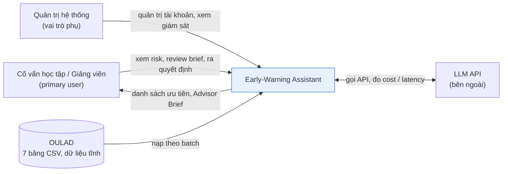

**Ranh giới**: không kết nối LMS thật; không có kênh gửi thông báo tới sinh viên; mọi đầu ra dừng ở màn hình cố vấn (out of scope của đề bài).

### 2.2. Kiến trúc phân tầng

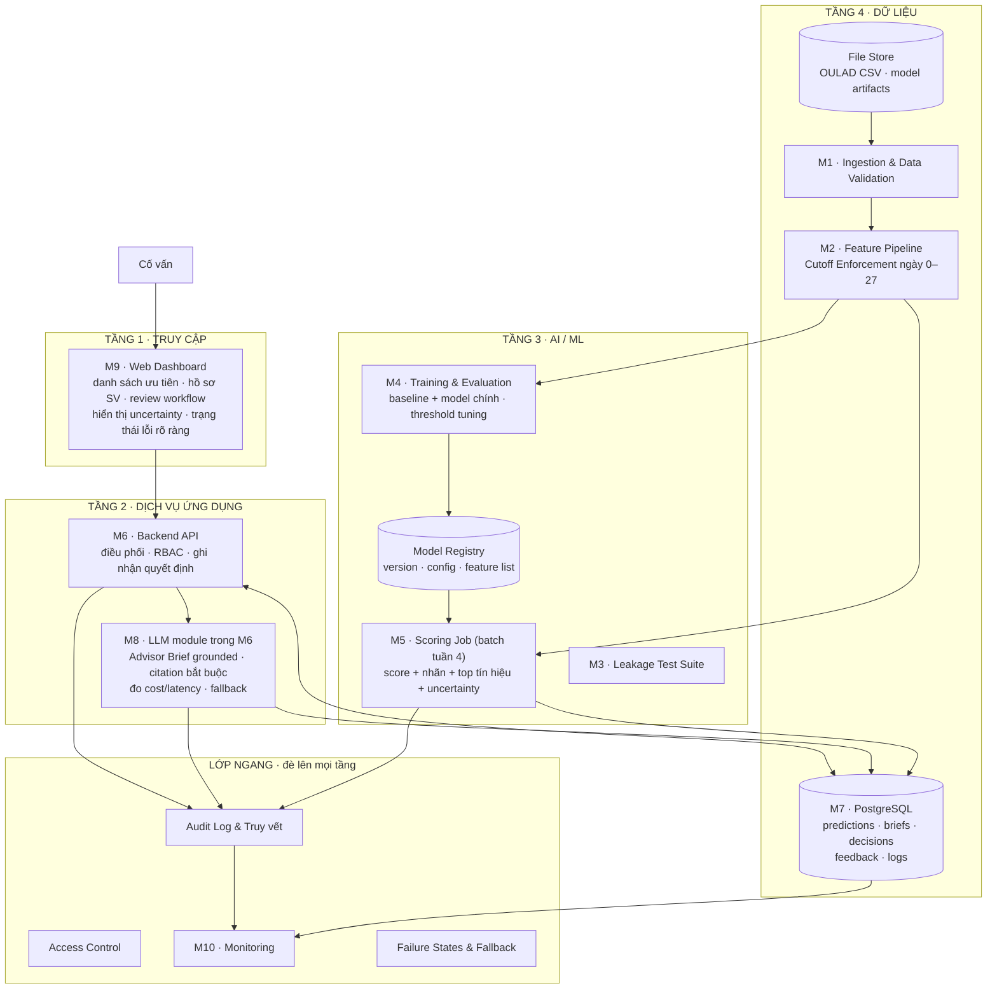

### 2.3. Các pattern áp dụng

| # | Pattern | Cơ sở / dẫn chiếu | Vấn đề trong bài toán | Điểm áp dụng |
|---|---|---|---|---|
| PT-1 | **Human-in-the-Loop Decision** | MLIP ch. 7.3a — thiết kế tương tác Human-AI | Human oversight 100%; không tự quyết can thiệp | Toàn bộ luồng C: mọi brief/đề xuất phải qua cố vấn (FR-07) |
| PT-2 | **Two-Stage Prediction** | MLIP ch. 9 — "model rẻ sàng lọc toàn bộ, phần đáng ngờ mới xử lý kỹ" | Alert overload: cố vấn không thể xem hết mọi hồ sơ | ML batch sàng lọc cohort → cố vấn chỉ review phần được gắn cờ, ưu tiên theo score |
| PT-3 | **Guardrails** | MLIP ch. 7.3c — hàng rào bảo vệ | LLM hallucination / nhận định không có căn cứ | M8: output schema bắt buộc + validation citation, fail → regenerate → fallback |
| PT-4 | **Design for Failure (explicit failure states + fallback)** | MLIP ch. 7.3 | FR-08; Risk *ML/LLM/API Failure* | Lớp ngang Failure States; M8 fallback; M9 hiển thị trạng thái lỗi |
| PT-5 | **Point-in-Time Feature Pipeline (cutoff enforcement)** | Thực hành MLOps — point-in-time join; ASM-02 | Temporal leakage — kết quả offline giả tạo | M2: feature catalog khai báo as-of; M3: leakage test như CI gate |
| PT-6 | **Data Schema Validation + Data Linting** | MLIP ch. 16.4 | Dữ liệu OULAD nhiễu, thiếu, lệch schema | M1: schema check, integrity check, data linting, quarantine |
| PT-7 | **Model Registry + Versioning (không ghi đè)** | MLIP ch. 24 — chống-pattern ghi đè model production | FR-03 (model version); truy vết dự đoán về model/config | Registry trong M4; mọi prediction gắn `model_version` |
| PT-8 | **Prediction Logging** | MLIP ch. 24.6c — "chìa khóa truy vết" | FR-09; debug dự đoán sai; đánh giá Product/User value | M5 + M7: ghi input snapshot hash, model version, tín hiệu, thời điểm |
| PT-9 | **Drift Monitoring + Slice Evaluation** | MLIP ch. 16.5 | Risk *Domain Shift / Bias* — chất lượng không đồng đều giữa học phần/kỳ | M10: slice metrics theo module/presentation; cảnh báo lệch phân bố |
| PT-10 | **Containment & Isolation (data minimization)** | MLIP ch. 7.3f; Privacy & fairness | Thông tin cá nhân lộ ra ngoài thẩm quyền | M8 chỉ nhận context tối thiểu ≤ cutoff; module có interface cô lập, mock được; log bảo vệ |

### 2.4. Lý do lựa chọn kiến trúc và phương án bị loại

**Kiến trúc chọn: Modular Monolith (API + DB + UI, gồm LLM module) + Batch ML Pipelines.**

| Quyết định | Phương án loại bỏ | Lý do |
|---|---|---|
| **PA-1: Scoring batch mô phỏng cuối tuần 4** | Online serving qua API | OULAD là dữ liệu lịch sử tĩnh — không có dòng sự kiện thật chảy vào. Batch cho kết quả tất định, tái lập được (MLIP ch. 24), đủ cho demo + đánh giá. Online chỉ cần thiết khi có LMS thật (out of scope). |
| **PA-2: LLM module có ranh giới nội bộ trong Backend API** | Triển khai LLM thành service/container riêng | Prototype chỉ có một backend và một máy demo; gọi module nội bộ giảm container và hop mạng. Module vẫn tách interface để mock khi kiểm thử, xử lý timeout/fallback, giảm thiểu context và đo cost/latency độc lập. Chỉ cân nhắc tách service khi có nhu cầu triển khai hoặc mở rộng độc lập. |
| **PA-3: Modular monolith** | Microservices đầy đủ | Đội quy mô nhóm sinh viên, 1 deployment target (demo). Microservices tăng chi phí vận hành không mang lại giá trị ở quy mô này; ranh giới module nội bộ (M1–M10) vẫn giữ được khả năng tách sau. |
| **PA-4: PostgreSQL** | SQLite | FR-09 cần RBAC + audit log thực dụng; Postgres cho concurrency giữa API — Scoring Job, và JSONB lưu tín hiệu/citation. |
| **PA-5: React dashboard** | Streamlit | FR-07 cần workflow trạng thái (edit/accept/reject) + FR-09 cần phân quyền theo vai trò — Streamlit yếu ở cả hai. React + FastAPI chi phí chấp nhận được. |
| **PA-6: Grounding trực tiếp (không RAG) giai đoạn đầu** | RAG với guidelines | Đề bài cho phép bỏ RAG nếu grounding khác đạt yêu cầu. Guidelines là bộ tài liệu nhỏ, tĩnh → nhét đủ vào context. Chỉ nâng cấp RAG nếu rubric LLM cho thấy thất bại (mục 3.8). |

### 2.5. Quan điểm triển khai (Deployment)

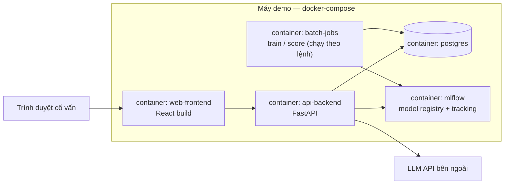

Toàn bộ hệ thống chạy trên một máy demo qua `docker-compose`; batch jobs kích bằng lệnh (mô phỏng mốc "cuối tuần 4"). Chi tiết từng container xem mục 3.

---

## 3. Thiết kế chi tiết từng thành phần

### 3.1. M1 — Ingestion & Data Validation

**Trách nhiệm**: nạp 7 bảng OULAD vào file store chuẩn hoá (Parquet), kiểm tra chất lượng trước khi bất kỳ thành phần nào khác được phép dùng dữ liệu.

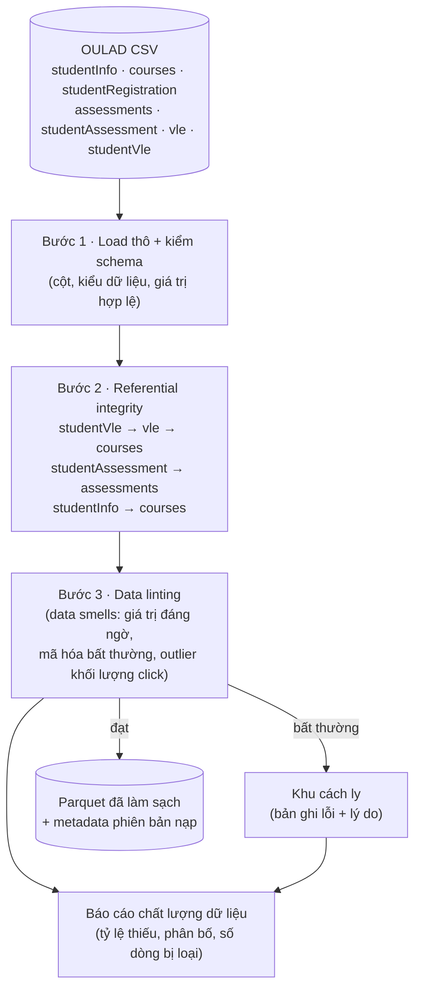

**Quy tắc chính**:
- Schema của từng bảng khai báo tĩnh; sai schema → chặn toàn bộ lần nạp (fail fast).
- Bản ghi vi phạm integrity → **cách ly + ghi lý do**, không âm thầm bỏ.
- Báo cáo chất lượng được M10 lưu lại làm baseline so sánh drift các lần nạp sau.

### 3.2. M2 — Feature Pipeline & Cutoff Enforcement

**Trách nhiệm**: biến dữ liệu đã làm sạch thành feature snapshot tại mốc dự báo (ngày 0–27), với **bằng chứng thời gian** cho từng feature. Đây là **điểm kiểm soát leakage duy nhất** của hệ thống (P1).

**Cơ chế cốt lõi — Feature Catalog**: mỗi feature khai báo (bảng nguồn, cách tổng hợp, điều kiện thời gian hợp lệ). Pipeline **tự động áp cutoff** cho mọi feature dựa trên khai báo; feature không chứng minh được as-of time → **bị loại khỏi benchmark** (ASM-02).

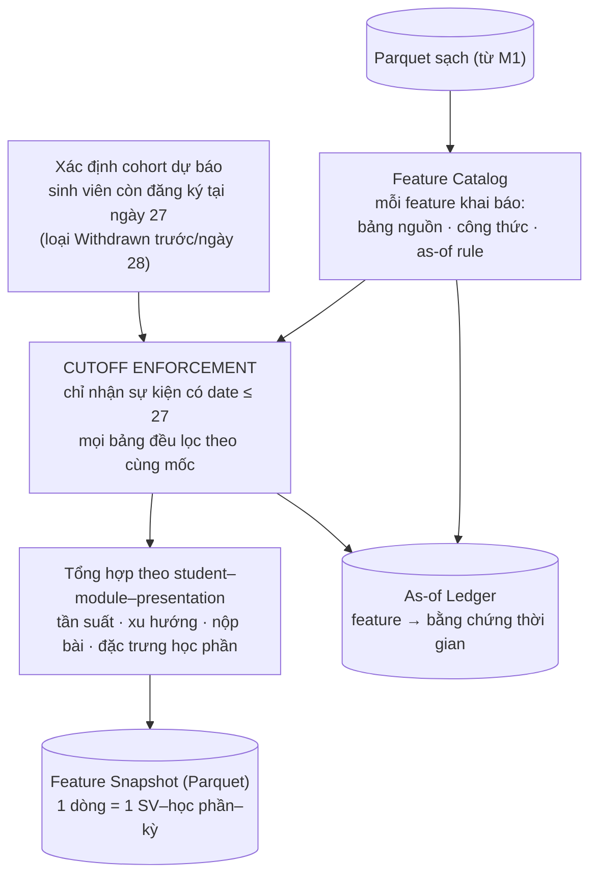

**Ví dụ khai báo trong catalog**:

| Feature | Bảng nguồn | As-of rule | Tổng hợp |
|---|---|---|---|
| `n_clicks_before_cutoff` | studentVle | `date <= 27` (gồm date âm — xem trước trước khai giảng) | tổng số click |
| `click_trend_w3_w4` | studentVle | `date BETWEEN 14 AND 27` | so sánh tuần 3–4 vs tuần 1–2 |
| `n_submitted_before_cutoff` | studentAssessment ⋈ assessments | `date_submitted ≤ 27` | số bài nộp |
| `avg_score_submitted` | studentAssessment ⋈ assessments | `date_submitted ≤ 27` | điểm TB các bài đã nộp |
| `module_presentation` | courses | tĩnh | mã học phần/kỳ |
| ~~`final_result`~~ | studentInfo | — | **bị loại — là target** |

**Output schema của snapshot**: `id_student, code_module, code_presentation, [features...], feature_list_hash, snapshot_version`.

### 3.3. M3 — Leakage Test Suite

**Trách nhiệm**: chứng minh cơ chế cutoff đúng — chạy như **CI gate**, không pipeline nào đạt trạng thái "sẵn sàng" nếu fail.

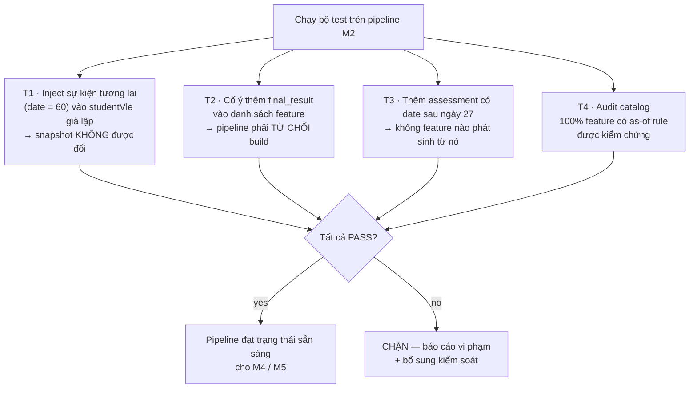

Đối ứng tiêu chí "Temporal correctness: 100% trường hợp cố ý đưa dữ liệu tương lai hoặc target vào features phải bị phát hiện/chặn".

### 3.4. M4 — Training & Evaluation

**Trách nhiệm**: huấn luyện baseline + model chính theo giao thức chung, chọn threshold trên validation, đăng ký model vào Registry.

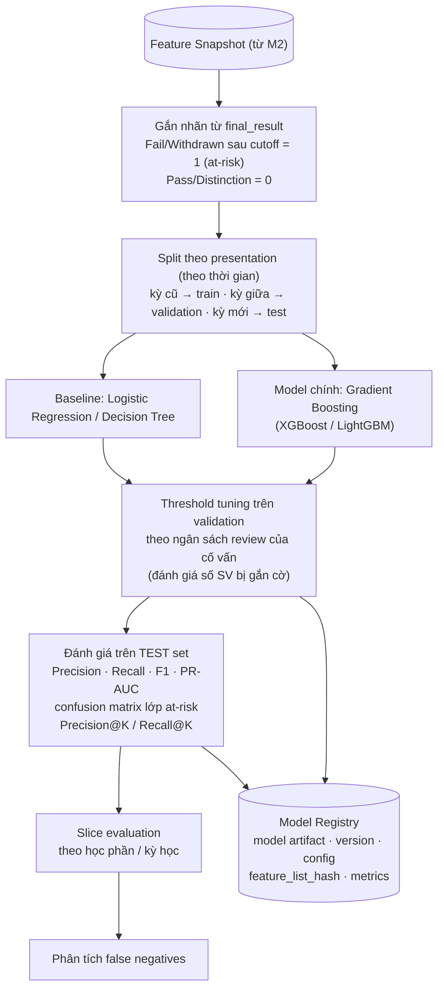

**Quy ước bắt buộc**:
- Split **theo thời gian** (presentation) chứ không trộn ngẫu nhiên — đối ứng yêu cầu "validation theo thời gian" trong bảng rủi ro.
- Cùng một split, cùng test set cho baseline và model chính — đối ứng "sử dụng chung train/validation/test protocol".
- Chỉ model **đã qua M3** mới được đăng ký.
- Threshold là **một phần của artifact** đăng ký kèm model (đổi threshold = đổi version).

### 3.5. M5 — Scoring Job (batch cuối tuần 4)

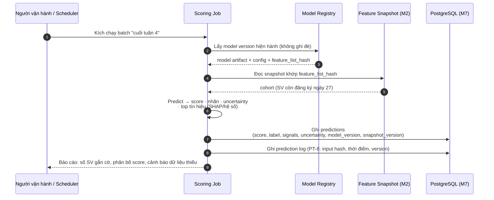

**Ghi chú thiết kế**:
- Job **không bao giờ sửa** prediction đã ghi — chạy lại = version mới (tất định, tái lập).
- Sinh viên thiếu dữ liệu → status `insufficient_data`, không score (FR-08).
- Top tín hiệu: với LR dùng hệ số × giá trị chuẩn hoá; với GBM dùng SHAP values. Là **tín hiệu tương quan, không phải nhân quả** — ghi chú này được gắn kèm trong dữ liệu hiển thị (FR-05).

### 3.6. M6 — Backend API

**Trách nhiệm**: cổng duy nhất cho Dashboard; thực thi RBAC; ghi nhận quyết định cố vấn; điều phối M8.

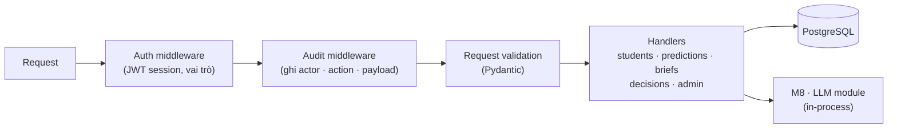

**Danh sách endpoint chính**:

| Method | Path | Vai trò | Chức năng | FR |
|---|---|---|---|---|
| POST | `/auth/login` | — | Đăng nhập, cấp session | FR-09 |
| GET | `/students?risk=&sort=priority` | advisor | Danh sách SV kèm risk/priority | FR-04 |
| GET | `/students/{id}` | advisor | Hồ sơ: tín hiệu, uncertainty, trạng thái dữ liệu | FR-04, FR-05 |
| POST | `/briefs/generate` | advisor | Yêu cầu tạo brief cho 1 hồ sơ | FR-06 |
| GET | `/briefs/{id}` | advisor | Đọc brief + citation | FR-06 |
| PUT | `/briefs/{id}` | advisor | Sửa nội dung brief (tạo version mới) | FR-07 |
| POST | `/briefs/{id}/decision` | advisor | accept / reject + phản hồi | FR-07 |
| GET | `/admin/monitoring/*` | admin | Metrics dữ liệu/model/LLM/hệ thống | FR-09 |

**Nguyên tắc**: Lời gọi tới LLM chỉ đi từ M8 bên trong M6; Dashboard không gọi LLM API trực tiếp. M8 dùng client có timeout, retry giới hạn và fallback. Không có endpoint nào thực hiện hành động với sinh viên — kiến trúc physically enforce P2.

### 3.7. M7 — Database

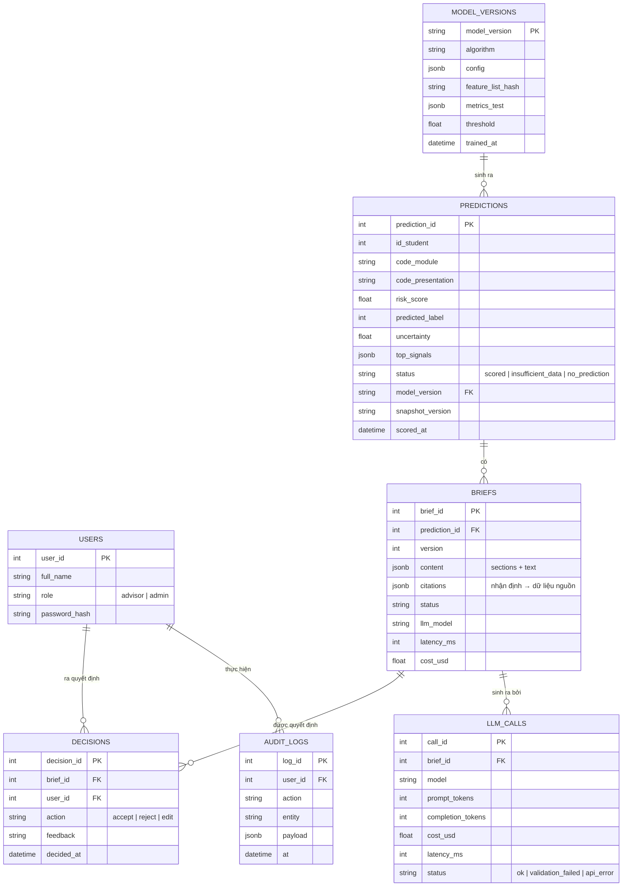

**Ghi chú**:
- `BRIEFS` giữ **mọi version** (không ghi đè — cùng chống-pattern như model, MLIP ch. 24): sửa brief → version mới, version cũ còn nguyên phục vụ truy vết.
- `PREDICTIONS.status` hiện thực hoá P4: `insufficient_data` và `no_prediction` là trạng thái hợp lệ, không phải lỗi âm thầm.
- `DECISIONS` là sự kiện first-class (P2): nguồn dữ liệu cho Human-oversight 100% và bài so sánh Product/User value.

### 3.8. M8 — LLM module trong Backend API

**Trách nhiệm**: tạo Advisor Brief **grounded** — mỗi nhận định thực tế phải dẫn được về dữ liệu nguồn; tuân thủ toàn bộ ràng buộc mục 2.2 của đề bài.

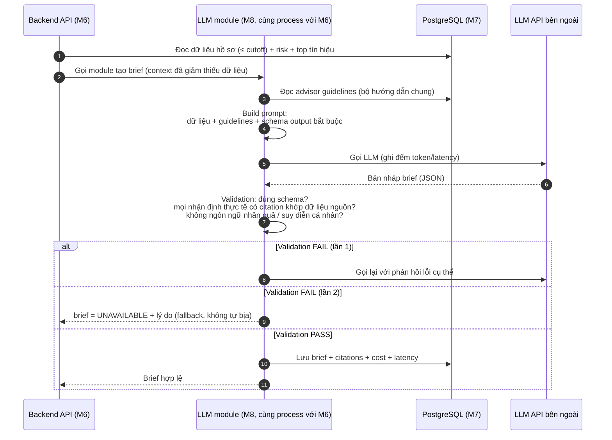

**Ràng buộc đề bài → cơ chế hiện thực**:

| Ràng buộc (spec 2.2) | Cơ chế trong M8 |
|---|---|
| Không suy diễn cá nhân ngoài dữ liệu | Prompt cấm + validator kiểm tra nhận định có citation |
| Không biến feature importance thành nhân quả | Prompt dùng khung "tín hiệu liên quan" + validator từ chối ngôn ngữ nhân quả |
| Không nhận định động cơ/năng lực/tâm lý | Prompt cấm + checklist rubric khi đánh giá |
| Không tự quyết can thiệp / gửi SV | Brief chỉ chứa "gợi ý để cân nhắc" — schema không có trường hành động |
| Thiếu dữ liệu → nêu giới hạn | Context builder gắn cờ `insufficient_data` vào prompt → brief có mục "Giới hạn dữ liệu" |

**Fallback khi LLM không khả dụng** (FR-08): M8 trong Backend API đánh dấu brief "UNAVAILABLE" kèm lý do; Dashboard hiện trạng thái này để cố vấn viết brief thủ công từ tín hiệu đã hiển thị — **không bao giờ** hiển thị brief cũ như thể nó mới, không tự sinh thay thế.

**Về RAG**: mặc định grounding trực tiếp (guidelines nhỏ, tĩnh). Kích hoạt RAG chỉ khi rubric đánh giá cho thấy LLM bỏ sót nguyên tắc trong guidelines.

### 3.9. M9 — Dashboard

**Trách nhiệm**: toàn bộ giao diện cố vấn. Thiết kế theo nguyên tắc: dự đoán là **đầu vào để xem xét**, không phải kết luận; uncertainty luôn hiển thị; mọi trạng thái lỗi thấy được.

**Các màn hình**:

| Màn hình | Nội dung chính | FR |
|---|---|---|
| S1 · Đăng nhập | Xác thực theo vai trò | FR-09 |
| S2 · Danh sách ưu tiên | SV gắn cờ, sắp theo priority (score × độ không chắc chắn), cờ trạng thái dữ liệu, bộ lọc theo học phần | FR-04 |
| S3 · Hồ sơ sinh viên | Tín hiệu học tập (kèm nhãn "tương quan, không nhân quả"), khoảng cách tới threshold, dữ liệu còn thiếu | FR-05 |
| S4 · Review brief | Brief + citation bấm được → đối chiếu dữ liệu nguồn; sửa/chấp nhận/từ chối + phản hồi | FR-06, FR-07 |
| S5 · Trạng thái hệ thống | Cờ khi ML/LLM/dữ liệu lỗi, hướng dẫn fallback | FR-08 |

**Vòng đời brief (state machine)**:

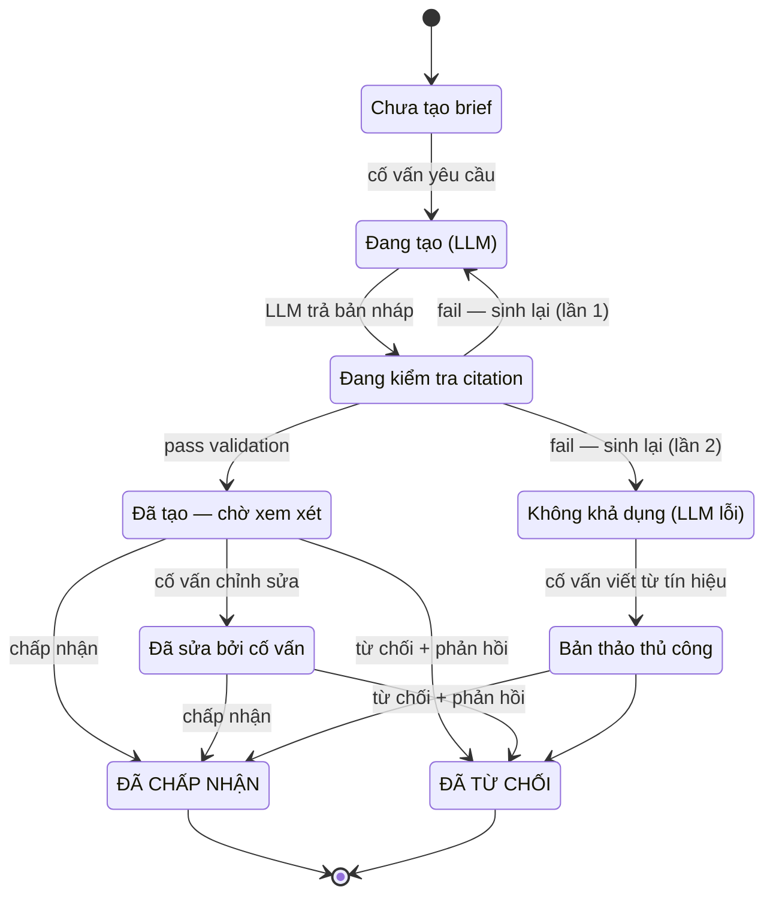

Mọi chuyển trạng thái ghi vào `DECISIONS` + `AUDIT_LOGS` (P3). Không có trạng thái nào tự chuyển sang `ACC` mà không qua thao tác của cố vấn.

### 3.9-bis. Hiển thị uncertainty (FR-05) — quy ước chung

| Dữ liệu | Cách hiển thị | Điều cấm |
|---|---|---|
| Risk score | Xác suất + nhãn "điểm gợi ý ưu tiên" | Gọi là "kết luận" |
| Vị trí threshold | Thanh trực quan score vs threshold | Ẩn threshold |
| Độ không chắc chắn | Khoảng cách tới threshold + trạng thái calibration | Chỉ hiện nhãn 0/1 |
| Tín hiệu | Top-N đóng góp, ghi chú tương quan | Diễn giải nhân quả |
| Thiếu dữ liệu | Nhãn lý do rõ ràng | Im lặng, score mặc định |

### 3.10. M10 — Monitoring & Audit

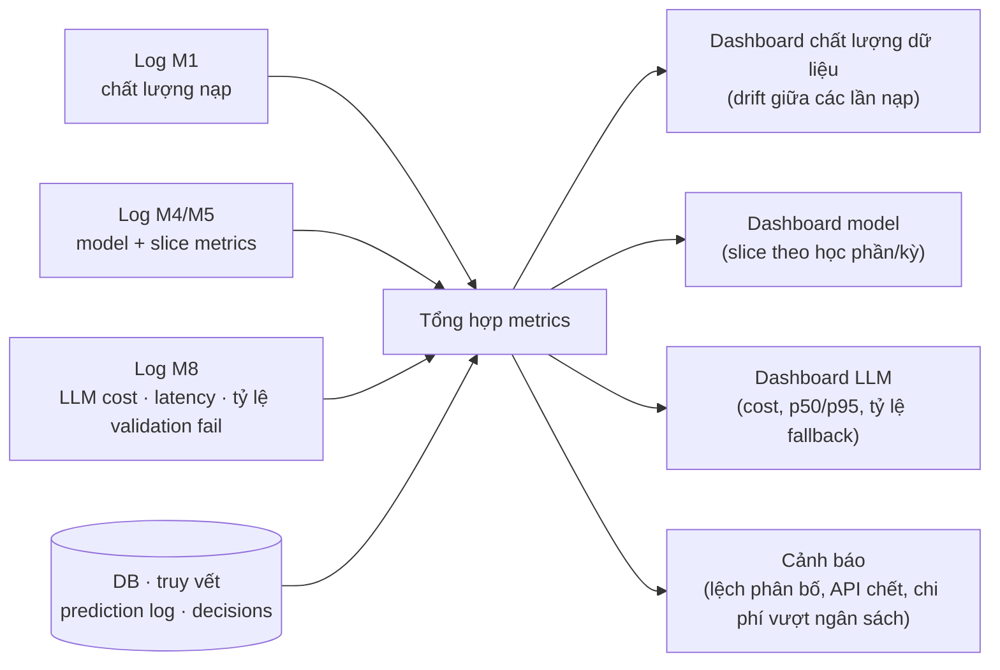

| Chiều đo (bảng chất lượng đề bài) | Metric | Nguồn |
|---|---|---|
| ML quality | P/R/F1/PR-AUC, confusion matrix | M4, ghi vào Registry |
| Early detection | Recall tại tuần 4 + phân tích FN | M4 |
| Alert workload | Precision@K, tỷ lệ SV gắn cờ | M4, M7 |
| LLM quality | Rubric có người kiểm tra (đánh giá ngoài hệ thống, M8 cấp dữ liệu) | M8 |
| Temporal correctness | Tỷ lệ pass M3 = 100% | M3 |
| System performance | p50/p95 latency brief, thời gian batch, chi phí LLM | M7 (`LLM_CALLS`) |
| Privacy | Số truy cập ngoài thẩm quyền = 0; dữ liệu gửi LLM ≤ cutoff | M6 audit |
| Reliability | Tỷ lệ fallback, trạng thái lỗi | M10 |

---

## 4. Ma trận truy vết Yêu cầu → Thiết kế

| FR | Component | Cơ chế |
|---|---|---|
| FR-01 | M1, M2 | Ingestion + feature pipeline tạo features tại mốc xác định |
| FR-02 | M2, M3 | Cutoff enforcement + leakage test CI gate |
| FR-03 | M4, M5 | Registry + scoring ghi score/nhãn/model version |
| FR-04 | M6, M9 | API + Dashboard danh sách ưu tiên |
| FR-05 | M5, M9 | Uncertainty trong prediction record + quy ước hiển thị (3.9-bis) |
| FR-06 | M8 | Brief grounded, citation đối chiếu dữ liệu nguồn |
| FR-07 | M6, M7, M9 | Workflow brief + DECISIONS/feedback |
| FR-08 | M8, M9 | Fallback + trạng thái lỗi hiển thị rõ |
| FR-09 | M6, M7, M10 | RBAC + audit log + prediction logging + monitoring |

| Rủi ro (spec mục 6) | Kiểm soát bắt buộc | Điểm hiện thực |
|---|---|---|
| Temporal/Data Leakage | Feature cutoff, validation theo thời gian, leakage test | M2, M3, split M4 |
| False Negative | Đánh giá recall, phân tích missed cases | M4 (FN analysis) |
| False Positive / Alert Overload | Threshold tuning, Precision@K, review workload | M4 (TH), M9 (S2) |
| Domain Shift / Bias | Slice evaluation, monitoring | M4 (SLICE), M10 |
| LLM Hallucination | Grounding, kiểm tra nguồn, human review | M8 (validation), M9 (S4), PT-1 |
| Privacy / Security | Data minimization, access control, bảo vệ log | M6 (RBAC), M8 (context tối thiểu), M7 |
| Human/Workflow Failure | UI hỗ trợ kiểm chứng, lưu quyết định | M9 (S3, S4), M7 (DECISIONS) |
| ML/LLM/API Failure | Error handling, explicit failure states, fallback | Lớp ngang + M8 + M9 (S5) |

| Giả định (ASM) | Xác minh ở đâu |
|---|---|
| ASM-01 | Slice evaluation M4/M10 — nêu giới hạn tổng quát hoá trong báo cáo |
| ASM-02 | Feature Catalog + T4 audit (M3) — feature không chứng minh as-of bị loại |
| ASM-03 | Hiển thị proxy + nhãn "tín hiệu tương quan" ở M9 |
| ASM-04 | Kịch bản demo S2→S4; đo thời gian review phục vụ Product/User value |
| ASM-05 | Fallback M8/M5 + monitoring M10 — kiểm thử tình huống tắt LLM/API |

---

## 5. Hướng mở rộng (ngoài phạm vi hiện tại)

- **RAG** cho guidelines nếu rubric LLM thất bại ở grounding trực tiếp.
- **Online serving** khi có LMS thật (thay batch bằng stream + re-scoring định kỳ).
- **Continuous learning**: retrain theo lịch khi thêm kỳ mới —Registry sẵn sàng cho việc này (chỉ thêm job, không đổi kiến trúc).
- Mở rộng slice evaluation fairness (nhóm demographics) nếu yêu cầu đánh giá fairness chi tiết hơn.

---

## Phụ lục A. Quy tắc đặt tên & versioning

| Đối tượng | Định dạng | Ví dụ |
|---|---|---|
| Feature snapshot | `snapshot_v{n}_{feature_list_hash[:8]}` | `snapshot_v3_1a2b3c4d` |
| Model version | `model_{alg}_{date}_{hash[:8]}` | `model_gbm_20261018_9f8e7d6c` |
| Brief | `brief_{prediction_id}_v{n}` | `brief_1042_v2` |
| Prompt template | `prompt_{purpose}_v{n}` (nằm trong git) | `prompt_brief_v5` |

## Phụ lục B. Quyết định mở cần nhóm chốt trước khi cài đặt

1. Model chính: XGBoost hay LightGBM (chi tiết M4).
2. Ngân sách review giả định cho threshold tuning: gắn cờ tối đa ~top K% cohort? (chi tiết M4/TH).
3. LLM provider cụ thể theo budget nhóm (chi tiết M8).
4. Số lượng kịch bản demo cho bài đánh giá Product/User value (chi tiết ASM-04).
